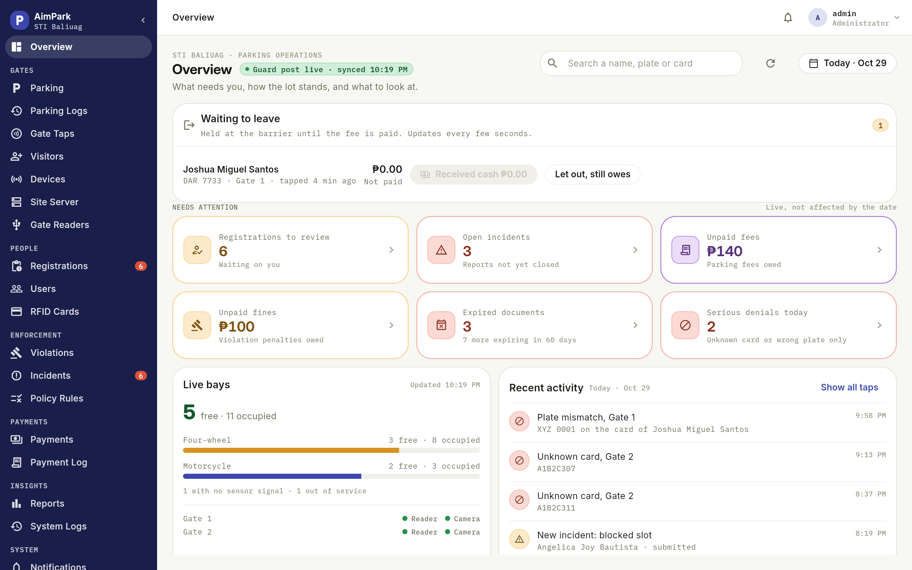
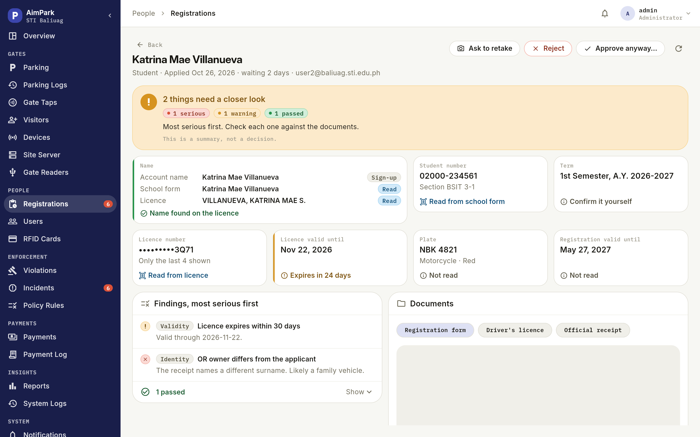
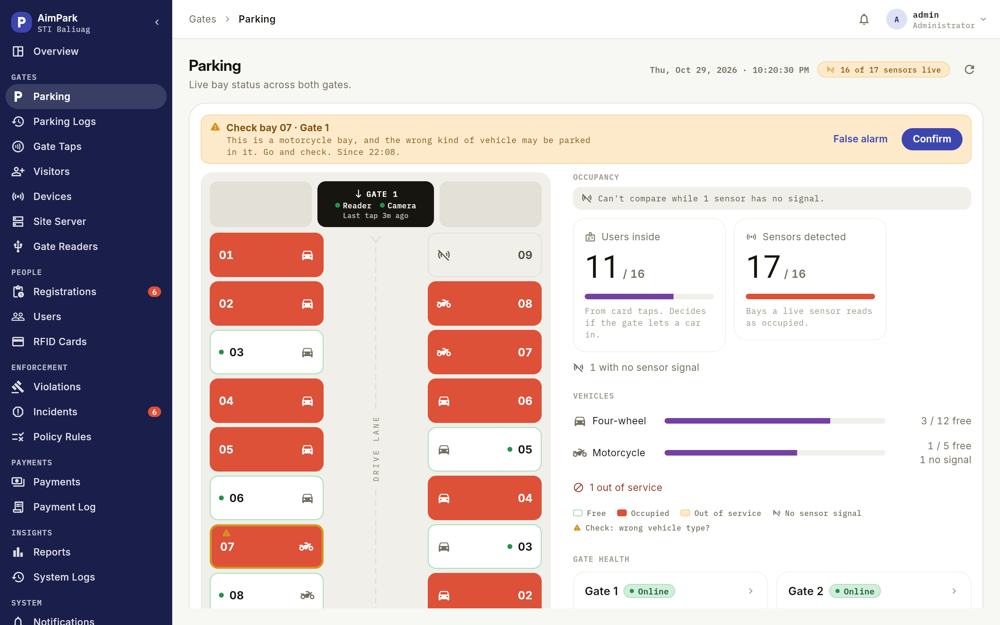
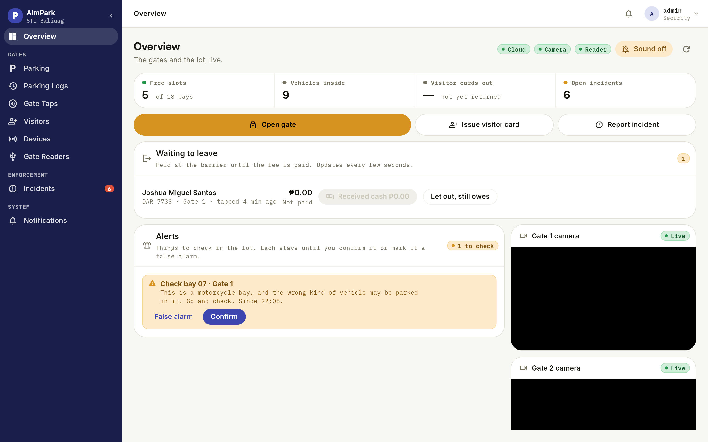
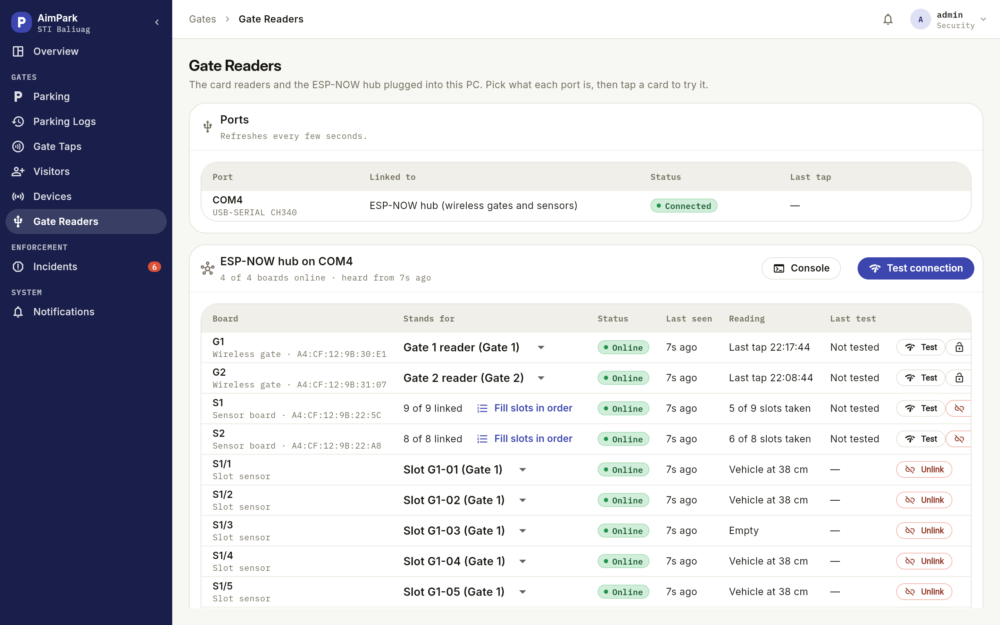
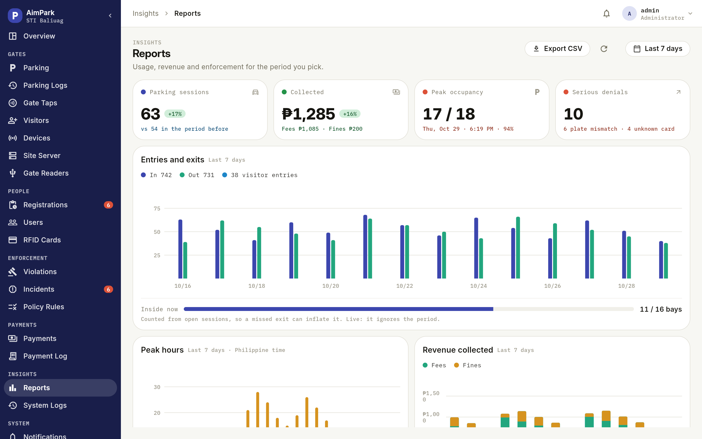

# AimPark

**RFID + license-plate smart parking for STI College Baliuag.**
A driver taps a card at the gate, a camera checks the plate, the barrier opens, the fee is worked out by the hour, and the driver pays from their phone. The guard and the admin watch it all live.

Built solo as a capstone project, and used as a real system, not a demo.

**Live admin panel:** https://aim-park.web.app

## See it

All screens below use made-up drivers, plates and numbers.

**Admin panel: the whole lot at a glance.** What needs attention, live bays, who was refused at the gate and why.



**Registration review.** The phone reads each document, the server cross-checks them, and the admin sees what matches, what was edited and what needs a closer look before any card is issued.



**Live parking map.** Each bay is driven by its own ultrasonic sensor, over ESP-NOW, into the site server. A wrong-vehicle warning and the gate health sit on the same page.



<table>
<tr>
<td width="50%"><b>Guard post.</b> The guard's own screen on the site server: open the gate, take cash, confirm a wrong-bay alert, watch both cameras.<br></td>
<td width="50%"><b>ESP-NOW hub.</b> The wireless gate boards and every slot sensor, with live readings, link status and a connection test.<br></td>
</tr>
</table>

**Reports.** Entries and exits, peak hours, revenue split into fees and fines, and gate outcomes.



## What it does

- **Registration with document checks.** A driver photographs their registration papers (RAF), driver's licence and OR/CR. The phone reads the text on-device (Google ML Kit), the server pulls the values out by their position on the page, and the driver confirms each value. An admin reviews every application before a card is issued.
- **Gate control.** Tap an RFID card, read the plate, check the account, open the barrier. One gate works as both entry and exit. A suspended card, an expired licence or a plate mismatch is blocked and flagged.
- **Live parking map.** Ultrasonic sensors report which of the slots are taken, and the map updates in real time.
- **Pay before exit.** The fee is worked out by the hour. If the driver hasn't paid, the exit barrier stays shut and the driver gets a push notification. The guard can take cash or let the driver out. Online payments go through PayMongo.
- **Violations and incidents.** Reports, penalties, appeals, and temporary or permanent card suspension.
- **Renewals.** Licence and OR expiry countdowns, with a renewal review flow.
- **Admin panel.** Registrations, users, RFID cards, visitor cards, parking, payments, violations, reports, audit logs and system logs.

## How it fits together

```
 ESP32 gate reader ─USB─┐                          ┌──────────────────────┐
 ALPR camera app ───────┼──► SITE SERVER ◄────────►│ CLOUD API (Render)   │
 Guard's browser ───────┘    + local Postgres      │ + Supabase           │
                                                   └──────────────────────┘
 ESP32 slot sensors ─ESP-NOW─► hub ─USB─► site server        ▲        ▲
                                                             │        │
                                              Flutter mobile app   Flutter admin web
```

The important design choice: **every gate decision is made on a local server at the school**, so the barrier keeps working when the internet is down. The cloud keeps registration, user data, payments, notifications, the mobile app and the admin panel. The two sync with each other.

## Tech stack

| Part | Folder | Built with |
|---|---|---|
| API | [`AimPark.API`](AimPark.API) | ASP.NET Core 8, EF Core, PostgreSQL (Supabase), SignalR, JWT, Firebase push |
| Admin web panel | [`aimpark_admin`](aimpark_admin) | Flutter Web, Riverpod, hosted on Firebase Hosting |
| Mobile app | [`aimpark_mobile`](aimpark_mobile) | Flutter, Riverpod, go_router, ML Kit text recognition, FCM |
| Plate recognition | [`alpr-service`](alpr-service) | Python, OpenCV, fast-alpr (ONNX), PySide6 |
| Site server | [`site-server`](site-server) | The same API running in "Site mode" as a Windows service, with its own local database |
| Firmware | [`firmware`](firmware) | ESP32, PlatformIO, RC522 RFID, HC-SR04 sensors, ESP-NOW |
| CI/CD | [`.github/workflows`](.github/workflows) | GitHub Actions: build and test, deploy API (Render, Docker) and admin (Firebase), release APK |

## Problems I had to solve

- **Gate decisions that survive no internet.** I moved all gate logic to a local site server and made the cloud sync with it, instead of having the barrier call the cloud.
- **Reading messy documents.** Philippine licences and ORs come in different layouts. Instead of trusting free-text OCR, the server reads values by their position on the page and the driver confirms them. Missing values trigger a retake.
- **Never charge or release the wrong car.** Entry and exit are one flow with pay-before-exit, and unpaid exits are held, not silently let through.
- **No typing card numbers.** The admin's desk reader sends the card ID straight to the browser over Web Serial (Chrome/Edge), so staff never copy a UID by hand.
- **Shared database, many branches.** One Supabase database serves local and deployed builds, so migrations had to be written to not break production.
- **Errors you can trace.** Unhandled server errors carry a trace ID that can be looked up in the admin panel's System Logs.

## Running it

Short version, API and admin:

```bash
# API  (http://localhost:5041)
cd AimPark.API/AimPark.API
dotnet run

# Admin web panel (must be port 5000 for CORS)
cd aimpark_admin
flutter run -d web-server --web-port 5000
```

Secrets are not in the repo. Copy the example config files (`appsettings.Site.example.json`, `firmware/aimpark_enroll_reader/secrets.example.h`, `alpr-service/config.example.json`) and fill in your own values.

More detail:
[`HOW_TO_RUN.txt`](HOW_TO_RUN.txt) ·
[Setup](MD%20files/SETUP.md) ·
[Deployment](MD%20files/DEPLOYMENT.md) ·
[Site server](MD%20files/SITE_SERVER.md) ·
[Firmware](firmware/README.md) ·
[Testing](MD%20files/TESTING.md) ·
[Troubleshooting](MD%20files/TROUBLESHOOTING.md)

## Tests

The API has an xUnit test project ([`AimPark.API.Tests`](AimPark.API/AimPark.API.Tests)) covering the gate rules, document expiry and renewals, duplicate-identity checks and the ESP-NOW hub.

```bash
cd AimPark.API
dotnet test
```

## Status

Working end to end on a test rig at the school. Online GCash/Maya payments are ready in code but run in simulated mode until the business account is verified.

## Author

Built by [e-roz](https://github.com/e-roz) — licensed under [MIT](LICENSE).
